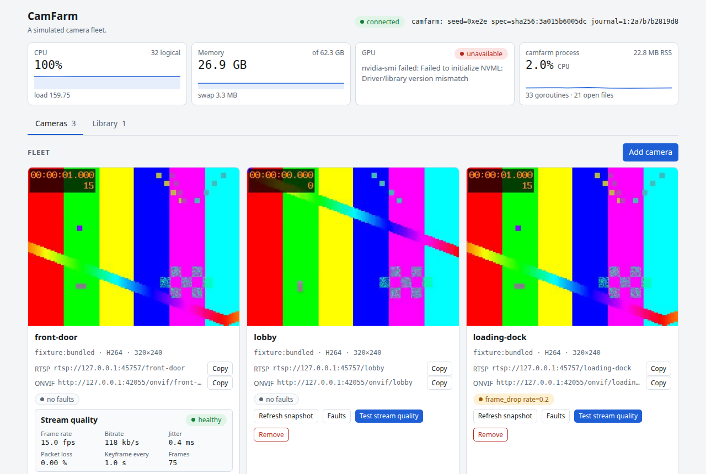
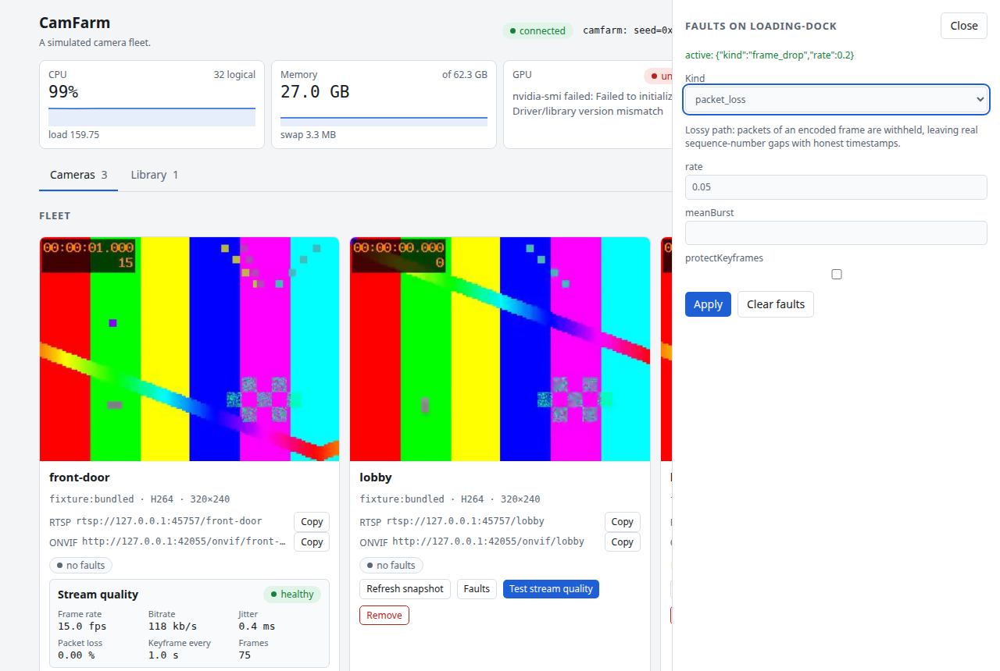
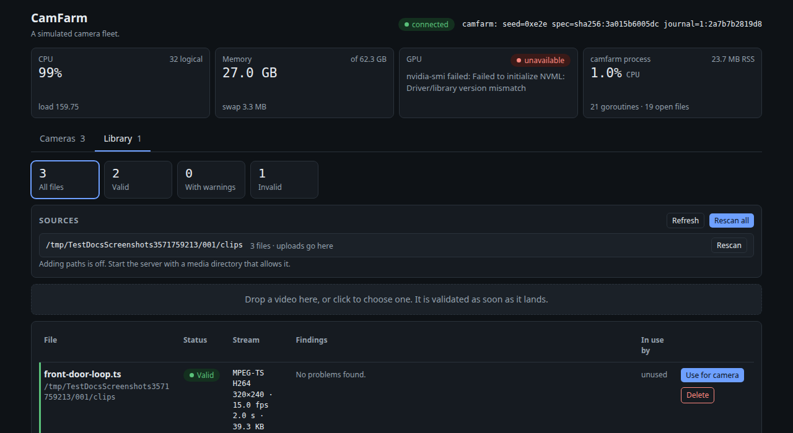

<p align="center"></p>

# CamFarm

[](https://github.com/0x524a/camfarm/actions/workflows/ci.yml)
[](https://codecov.io/gh/0x524a/camfarm)
[](https://sonarcloud.io/summary/new_code?id=0x524a_camfarm)

**Simulated fleet for pipeline testing. Not an ONVIF conformance tool.**

CamFarm is a synthetic RTSP camera farm for testing video-analytics pipelines without
physical hardware. It serves N fake cameras from one process, and it is built so
that misbehaviour can be injected deterministically: a fault fires because a
seed said it would, and the same seed and fleet spec reproduce it.

## Quick start

```sh
go run ./cmd/camfarm --cameras 3
```

The binary prints `dashboard: http://127.0.0.1:8080/`. Open it: every camera is a card with a
live snapshot and its RTSP and ONVIF URLs, each with a Copy button. Point your pipeline, `ffprobe`
or VLC at an RTSP URL from there (the RTSP and ONVIF ports are picked at random unless you pass
`--rtsp-port` and `--onvif-port`). Use your own footage with `--media-dir DIR`. Run with `-h` for
every flag.

In a container (Docker or nerdctl), see [docs/docker.md](docs/docker.md):

```sh
docker build -t camfarm .
docker run --rm -p 127.0.0.1:8080:8080 -p 127.0.0.1:8554:8554 -p 127.0.0.1:8000:8000 camfarm
```

**The dashboard has no authentication.** It can start servers, read local paths when you allow
it, and show host details and camera credentials. It listens on loopback by default. Do not
expose it. [Details](docs/dashboard.md).

## The dashboard

The screenshots below come from `TestDocsScreenshots`, a Playwright test. The committed images
were made by running it on a development machine with the command at the end of this section;
CI runs the same test on every change, which fails if the page stops showing these views, and
keeps its own images as the `dashboard-screenshots` build artifact. Nothing is mocked: the host
figures are the machine's own (the GPU tile says why it is unavailable when there is no
`nvidia-smi`), the library verdicts come from the real validator, and the stream quality result
is a real run.



**Cameras.** One card per camera, with the stream's source, codec and size, fault chips, and a
stream quality test that reports frame rate, bitrate, jitter, packet loss and keyframe interval.



**Faults.** The drawer lists the catalogue's kinds and parameters, shows what is active on the
camera and clears it. What each fault does, and where its determinism stops, is in
[docs/faults.md](docs/faults.md).



**Library.** Every file in your media directories is validated once per change, and each problem
is written out, so a file that cannot be served is explained before it becomes a camera. See
[docs/library.md](docs/library.md).

To regenerate the images:

```sh
CAMFARM_DOCS_SHOTS=$PWD/docs/assets go test -tags e2e -count=1 -run TestDocsScreenshots ./internal/dashboard/
```

## Status

No tagged release yet, so the Go API and the JSON API can still change. What works, in brief:

- N RTSP cameras behind one listener, H.264 and H.265, from MPEG-TS, MP4 or fragmented MP4 sources.
- An ONVIF® Device and Media control plane, and an opt-in WS-Discovery responder.
- Ten seeded fault effects, injectable at startup or at runtime, with a replayable journal.
- A dashboard with a media library, a stream quality test and host metrics, and a JSON API.
- A Go API: `camfarm.Start(spec)` in a `TestMain`, `Fleet.AddCamera` and `Fleet.RemoveCamera`.

> Implements/supports the ONVIF® Device Service and Media Service
> specifications. This project is **not ONVIF conformant**, is not tested
> against the ONVIF conformance suite, and makes no claim to any ONVIF
> profile or add-on.

The full list, including what is not built yet, is in [docs/features.md](docs/features.md). More:
[dashboard and CLI](docs/dashboard.md), [faults](docs/faults.md), [media library](docs/library.md),
[stream quality test](docs/stream-quality.md), [host metrics](docs/host-metrics.md) and
[WS-Discovery](docs/discovery.md).

## Fault catalogue

Kept in step with the catalogue in `internal/fault` by a test that fails if this table drifts.

<!-- fault-table:start -->
| Kind | Implemented | Models |
|---|---|---|
| `frame_drop` | yes | Encoder skipping frames: a frame is never encoded, so RTP sequence numbers stay contiguous and the loss shows only as a timestamp jump. |
| `packet_loss` | yes | Lossy path: packets of an encoded frame are withheld, leaving real sequence-number gaps with honest timestamps. |
| `keyframe_starvation` | yes | Long-GOP camera: only every Nth keyframe is sent, so a client joining mid-stream cannot start decoding. |
| `rtsp_error` | yes | Flaky camera that answers 5xx or 454 to some DESCRIBE, SETUP or PLAY requests. |
| `teardown` | yes | Camera that drops live sessions; TCP reset when mode is reset. |
| `sdp_lie` | yes | SDP that misdescribes the stream: wrong codec, wrong parameter sets, wrong geometry or wrong Content-Base. |
| `jitter` | yes | Inter-arrival jitter: each frame leaves a seeded random time late (order kept), which stresses jitter-buffer sizing. |
| `burst_delivery` | yes | Bursty uplink or encoder buffering: frames are held and then released back-to-back, which overflows NVR queues. |
| `pts_dts_mismatch` | yes | B-frame camera that stamps presentation time into RTP: timestamps run out of order, so decoders report non-monotonic dts. |
| `pts_delayed` | yes | Camera whose timestamps lag capture, constantly or by drift: what a latency profiler such as framelag meets. |
| `accept_then_silence` | no | Camera that accepts the TCP connection and never answers. |
<!-- fault-table:end -->

## Use as a library

```go
f, err := camfarm.Start(ctx, camfarm.Spec{
	Seed:    0x3f2a9c81,
	Cameras: []camfarm.CameraSpec{{ID: "front-door"}, {ID: "lobby"}},
})
if err != nil {
	return err
}
defer f.Close()

cam, _ := f.Camera("front-door")
fmt.Println(cam.RTSPURL()) // rtsp://127.0.0.1:41569/front-door
```

In a test, `camfarm.StartT(t, spec)` binds an ephemeral port, stays silent, and
closes itself when the test ends.

## Scope: what this does not do

- **It simulates. It is not a conformance-tested implementation of anything, and
  it does not claim to be.** Testing a client against this farm tells you your
  client works against *this farm*. It does not tell you your client is correct
  against real hardware, and it says nothing about your own conformance to any
  specification.
- **No transcoding or rescaling.** A camera serves the codec and geometry its source
  already has; `VideoSpec` is refused when it disagrees with the source. Serving H.265
  means supplying an H.265 source. An encoder would be needed, no viable pure-Go H.265
  encoder exists, and cgo and a runtime `ffmpeg` are excluded by design.
- **Narrow container support.** MPEG-TS, plain MP4 and fragmented MP4, H.264 or H.265
  video only; audio is ignored. Matroska and MPEG-PS are not supported. Fragmented MP4
  needs each `trun` to carry a data-offset preset; a producer using the base-data-offset
  convention is refused rather than mis-parsed.
- **ONVIF: Device and Media services only.** Enough for a client to discover a camera and
  get its real RTSP URL. PTZ and Imaging are not implemented, and
  `GetCapabilities`/`GetServices` never advertise them. WS-Discovery is opt-in and is also
  a simulation; its limits, including how multicast behaves on real networks, are in
  [docs/discovery.md](docs/discovery.md). With discovery off, a client is given the ONVIF
  endpoint directly (`Camera.ONVIFEndpoint()`).
- **The bundled video is a fixture, not a sample.** A two-second 320×240 test pattern in
  H.264 and its H.265 counterpart, generated by `scripts/gen-fixture.sh`. Neither is
  representative of real camera bitrate, motion, noise or encoder behaviour.
- **Determinism has limits.** The decision sequence is reproducible from a seed;
  wall-clock timing is not, because serving a real client happens in real time. RTP SSRC
  is not reproducible (the RTSP library assigns it), so replay assertions exclude it;
  sequence numbers are reproducible. A live upstream source, not implemented yet, would be
  outside the guarantee.
- **No network-path impairment.** Bandwidth ceilings, reordering and other path effects
  need `tc`/`netem` and elevated privileges, and cannot be reproduced from a seed.
  `packet_loss` is a sender-side simulation (the camera chooses not to write packets).
  CamFarm owns only what a camera itself chooses not to send, or sends late.
- **Not a benchmark.** No cameras-per-core or memory-per-camera figure is published,
  because none has been measured. When one is, it will come from a committed benchmark.

## Requirements

Go 1.26 or later. No cgo, and no system packages at runtime. `ffmpeg` is needed
only to run the test suite, which cross-checks the served streams with `ffprobe`
and remuxes the bundled fixtures into MP4 to test the other container paths.
Regenerating the H.265 fixture additionally needs an `ffmpeg` built with
`libx265`; running the tests does not, because the fixture is committed.

## Licence

MIT. See [LICENSE](LICENSE).
